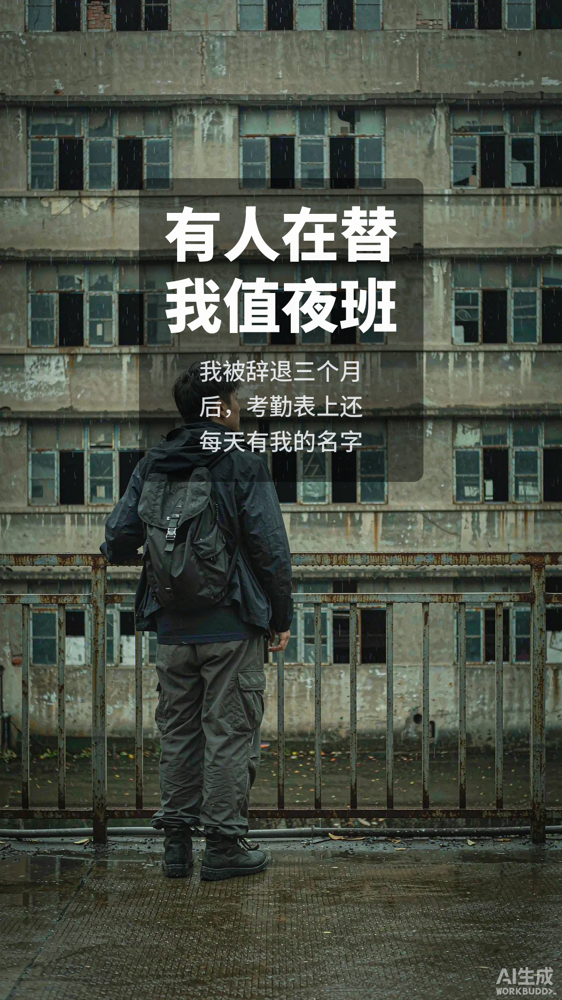

# explore-uncanny · 探险脑洞图文生成器

> 一个 Agent Skill：给一句选题，自动产出「伪纪实探险 × 怪诞巨物」竖版图文——**故事线 + 分镜 + 每帧生图提示词 + 出图 + 字幕 + 封面**。
> 固定方法论骨架，题材/主角/世界观每次都换。



---

## 这是什么

把一套被市场验证过的爆款图文方法论（伪纪录片外壳、逐级下沉、巨物尺度、去色冷调、渺小背影、结局反转），
做成**可换题材的流水线**。

- **锁死的**：三幕七拍骨架、每 5–6 帧空间升级、背影标尺、怪诞语法 R1–R6、结局"增量/反转"
- **每次都换的**：题材、主角、世界观、服化、结尾场景

两种子类型：
- **A · 宗教/民俗怪诞**（如深山禁寺那种：地下寺庙、蛇佛、巨像）
- **B · 寻亲悬疑 × 科幻巨构**（如雪山收到父亲信号：极地、飞船、全息）

---

## 产出长什么样

输入一句「废弃气象站」，得到：

```
01_选题卡.md        选题定位、核心恐怖、结尾增量
02_故事线.md        三幕七拍骨架 + 空间层级 + 不可逆点
03_分镜表.md        每帧：画面 / 怪诞规则 / 机位 / 人物占比 / 光照 / 字幕
scenes.json         机器可读，唯一事实来源
04_提示词全套.md    每帧完整提示词，可直接复制
prompts.json        同上，机器读
render_commands.txt 批量出图命令
out/subtitled/      成品图（叠好字幕）+ 00_封面.png
README.md           交付说明
```

---

## 快速开始

### 安装（有 skills 目录的 agent）

```bash
# 方案一：直接拷贝
cp -r explore-uncanny ~/.claude/skills/          # Claude Code
cp -r explore-uncanny ~/.openclaw/skills/        # OpenClaw
cp -r explore-uncanny <项目>/.codex/skills/       # Codex

# 方案二：从 SkillHub 装
skillhub install explore-uncanny --dir ~/.openclaw/skills
```

装完**重开会话**让 skill 注册。

### 用

对 agent 说：

> 按 explore-uncanny 做个「废弃气象站」题材的探险怪诞图文，直接出图。

或点名：`/explore-uncanny`

### 没有 skills 目录的 agent

把 `SKILL.md` + `references/01_方法论骨架.md` + `references/04_提示词拼装.md` 三份整段贴进对话当系统提示。

---

## 目录结构

```
explore-uncanny/
├── SKILL.md              主入口（五阶段流水线 + 执行契约 + 交付 checklist）
├── references/
│   ├── 01_方法论骨架.md      三幕七拍、结尾增量公式
│   ├── 02_视觉语言.md        色板/光照/机位/怪诞规则 R1–R6/人物尺度阶梯
│   ├── 03_场景模块库.md      5 类必备帧写法
│   ├── 04_提示词拼装.md      固定块 + 变量块拼装公式、负向词
│   ├── 05_题材适配.md        地下/水下/垂直/废墟/异境/时间 六类
│   ├── 06_验收清单.md        单帧 8 条 + 整组 6 条 + 挑图判据
│   ├── 07_输出目录规范.md
│   ├── 08_模板.md
│   ├── 09_字幕与后期.md      字号/字重/底框规范
│   ├── 10_实测结论.md        哪些词有效 / 哪些会反噬（含已撤回结论）
│   ├── 11_子风格-寻亲科幻.md  子类型 B 专属装置
│   ├── 12_封面规范.md        封面 ≠ 内容图
│   └── 13_新闻选题与去标识化.md  用真实事件做灵感但不暴露地址
├── scripts/
│   ├── gen_pack.mjs         scenes.json → 整套提示词 + 批量命令
│   ├── run_pipeline.mjs     一键脚手架 / 打包
│   ├── burn_subtitles.py    把字幕烧到图上（中文字体自动探测）
│   ├── make_cover.py        生成封面（大标题 + 副标题）
│   └── validate.mjs         验收：结构/字幕/封面/新闻脱敏
└── examples/
    ├── 版式示意.svg          封面与内容图版式矢量图
    ├── demo_scenes.json     4 帧完整可跑例子
    └── *_示例.png           真实成品（版式参照）
```

---

## 核心设计（为什么这样写）

| 原则 | 说明 |
|---|---|
| **纪实外壳优先** | 先让人信"这是真人拍的"，恐怖才成立。宁可像真的，不要好看。 |
| **风格靠固定前缀** | 所有帧共用同一段 STYLE，一个字不改。手写必漂。 |
| **人物尺度靠机位** | 平视 28–39%，陡俯视 7–13%。**写百分比无效**，别堆形容词。 |
| **怪诞靠规则组合** | 每帧取 2–3 条 R 规则（尺度错置/神圣×生物/递增复制/不可能几何/遮蔽窥视/日常入侵）。 |
| **中文绝不进生图** | 模型画中文必崩，字幕一律后期烧。 |
| **恐怖来自增量** | 结局是"多出来一样东西"，不是"看见怪物"。 |

---

## 依赖

- **Node.js**（跑 `gen_pack.mjs` / `validate.mjs`）
- **Python + Pillow**（跑 `burn_subtitles.py` / `make_cover.py`）
- **中文字体**：脚本自动找（Windows 微软雅黑 / macOS 苹方 / Linux Noto CJK）；或放一个到 `<项目>/fonts/`，得意黑（SmileySans）效果最"网感"

---

## 已知局限（诚实说明）

- **人物占比压不到目标值**：写"a speck / 不用指甲盖大"仍常画到 20%+。极端帧建议"空镜 + 后期贴人"。
- **词级结论来自 gemini 系**（含 hunyuan-image-alpha 实测）。换 gpt-image-2 需复验，负向策略可能不同。
- **不同生图模型对 `size` 参数支持不一**：有的传了报 400，需在提示词里写 "vertical portrait"。
- 详见 `references/10_实测结论.md`（其中"已撤回"一节记录了被证伪的旧结论）。

---

## 出处与合规

- 方法论来自对公开作品的**视觉语言与叙事结构**分析，抽象为可复用流程。
- 仅提供**方法**（骨架、提示词写法、流程），**不含任何原作者作品图片**。
- `examples/` 里的图是本 skill 自己生成的示例。
- 新闻/真实事件改编时，skill 内有**强制去标识化**流程（地名/机构/人名/时间/特征数字虚化 + 虚构层隔离）。
- 生成内容属 AI 生成物，发布请遵守平台 AI 标注要求。

---

## License

MIT
